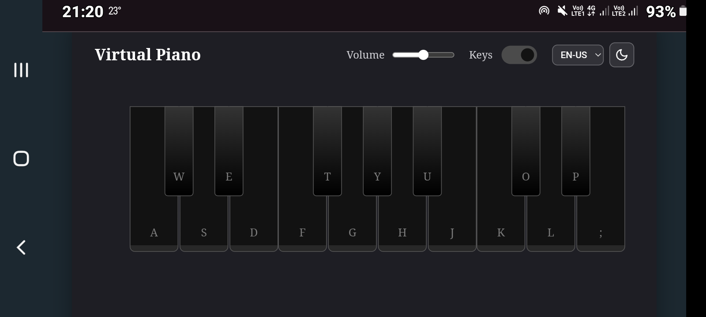

# Building a Piano Simulator with JavaScript and CSS

Project developed during the Potência Tech iFood Game Development Bootcamp, under the guidance of expert [Felipe Aguiar](https://github.com/felipeAguiarCode "Felipe Aguiar").

In this project challenge, we will build a fully functional piano simulator right in your browser. Take this opportunity to learn more about HTML, CSS, how to manipulate the browser's DOM using JavaScript.

## Features

- **Playable via Keyboard, Mouse & Touch**: Supports physical keyboard shortcuts, desktop mouse clicks, and mobile/tablet touchscreens.
- **Dark & Light Themes**: Defaults to Dark mode with an accessible Sun/Moon toggle switch.
- **Multilingual Support**: Instant UI translation between **English (`EN-US`)**, **Portuguese (`PT-BR`)**, and **Spanish (`ES-ES`)**, defaulting to English.
- **Volume Control & Key Labels**: Real-time audio volume slider and a toggle switch to show or hide keyboard hints on the keys.
- **Accessibility (A11y)**: Built with semantic HTML landmarks, ARIA labels, roles, focus rings, and keyboard navigation.

## Technologies Used

- **HTML5**: Semantic structure (`<main>`, `<header>`, `<section>`) and accessibility attributes (`ARIA` roles, labels, and keyboard navigation).
- **CSS3**: Custom properties (CSS variables) for Dark/Light theming, Flexbox layout, responsive media queries, and interactive key transitions.
- **Vanilla JavaScript**: DOM manipulation, Web Audio playback, pointer/keyboard event handling, theme toggling, and dynamic internationalization (`EN-US`, `PT-BR`, `ES-ES`).

## How to Run

1. Clone or download this repository.
2. Open `index.html` directly in any modern browser, or run it using a local development server (such as the **Live Server** extension in VS Code).

See [original repository](https://github.com/felipeAguiarCode/js-music-keyboard-virtual).

[LICENSE](/LICENSE)
